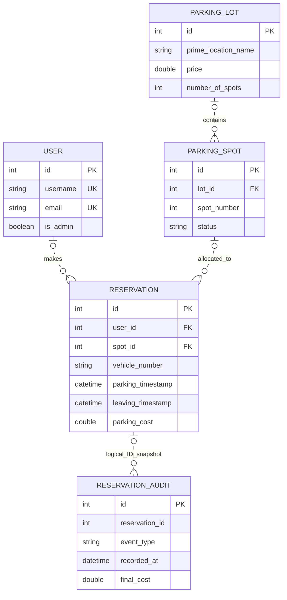

# ParkSmart DBMS mini-project report brief

This brief accompanies the college guidelines and the team’s earlier sample report. It describes the current Windows laptop implementation of **Smart Parking Management System**, called **ParkSmart** in the app. It supplies the project facts, SQL, and verification details needed to write the updated report even without access to the repository.

## Copy this request into ChatGPT with all three files attached

> Generate our updated BCS755A DBMS mini-project report as an editable Word document. Use the college guidelines for the required order, formatting, and signatures. Use this Markdown brief as the source for the current project, including the five tables, ER diagram, relational mapping, normalization, MySQL implementation, and test evidence. Use our earlier DOCX for the cover, team details, certificate layout, acknowledgement tone, and contents style. Its technical design and page numbers describe an earlier project version. Use the eight required chapters in order and keep the report within 50 pages. Render the ER diagram inside Chapter 2. Insert captioned placeholders for current screenshots that are unavailable and label unresolved administrative details `[CONFIRM]`. Keep the existing title and confirmed facts, including the Vue frontend, Python Flask backend, and MySQL `schema.sql` setup. Distinguish observed test results, fictional demo records, and possible future work. Create a Word table of contents and update its page numbers after final layout. If pagination cannot be verified, leave the TOC update pending and say so. Return the document with a short list of fields and screenshots we still need to supply.

## How to use the reference documents

| File | Use it for | Check before finalizing |
|---|---|---|
| `BCS755a_FINAL_DBMS_MINI_PROJECT_FORMAT _GUIDELINES.docx` | College report structure, page specifications, front sheet, footer and signatures | The stated submission deadline is 23 November 2026. Confirm any revised date with the department if relevant. |
| `Smart_Parking_DBMS_Report_With_Contents_Page_Numbers (1).docx` | The team’s previous title and cover layout, certificate format, acknowledgement and contents style | Use the current five-table schema and new diagrams from this brief. Replace the old contents page numbers and screenshot placeholders after layout. |
| `ParkSmart_DBMS_Report_Brief.md` | Current implementation facts and sample SQL for the DBMS lab | Treat the demo counts as a dated snapshot. They can change after bookings or releases. |

### Front matter details

- **College** Bangalore Institute of Technology, autonomous institution under VTU, K.R. Road, V.V. Puram, Bangalore 560004. Follow the existing cover’s wording and layout.
- **Department and subject** Department of Computer Science & Engineering. Database Management System Mini Project. Course code **BCS755A**. The certificate in the sample identifies the students as VII semester B.E.
- **Report title** **Smart Parking Management System**. Introduce ParkSmart as the app name in Chapter 1.
- **Academic year** The sample cover and certificate give **2026–2027**. The formatting guide identifies the cohort as **2023 Batch (2026–27 odd)**.
- **Team** Use the names and USNs in the sample as supplied and confirm the final roster. The sample lists three students, and the separate assignment instructions provided by the team call for four. Keep a clearly marked fourth-member placeholder pending confirmation. Use the same confirmed list on the cover, certificate, and acknowledgement.
- **Certificate** Use the official College certificate template if available and the sample for layout guidance. Leave the lab-in-charge names, signatures, designation, and approval date blank for completion. Keep the acknowledgement to one page.
- **Footer year** The guidelines explicitly say `Department of CS&E, BIT 2025-26`. The cover’s academic year is 2026–2027. Preserve the prescribed footer text as supplied and flag the discrepancy for the team to confirm before printing.
- **Project provenance** The team adapted an existing [Vehicle Parking App](https://github.com/namish18/vehicle-parking-app). Acknowledge the upstream project and describe verifiable work on the adapted app, including the MySQL migration, demo sign-ins, concurrency guards, release audit, and seed data. Use the local project and root `schema.sql` as the technical baseline. The remote default branch may describe an older version.

### Required Word layout

1. Front sheet in the specified layout, followed by College certificate, one-page acknowledgement, and contents with page numbers.
2. A4 paper, with a cream front sheet and spiral binding for the printed submission.
3. Margins of **1.3 inches left**, **1 inch right**, and **0.75 inches top and bottom**.
4. Times New Roman throughout. Body **12 pt**, subheadings **14 pt**, main headings **16 pt**.
5. Header has the project title at left. Footer has `Department of CS&E, BIT 2025-26` at left and the page number at right.
6. Start each chapter on a fresh page. Its first page has the footer only. Later pages in that chapter have both header and footer. In Word, use a section break per chapter and configure **Different First Page** with the first-page footer retained.
7. Use decimal numbering such as `2.1` and `2.2.1`. Build the contents from Word heading styles so the page numbers reflect the finished file. Update the page numbers again after inserting screenshots. Stay within **50 pages**.

## Chapter 1 — Introduction

**Overview.** ParkSmart is an implemented web app that manages current parking availability for multiple lots. A user chooses a lot and submits a vehicle registration number. The system allocates an available numbered spot, records a parking session, and updates availability. Releasing the spot closes the session, calculates a charge in rupees, and creates a database audit event. An administrator can manage lots and inspect usage and revenue summaries.

**Problem statement.** Manual parking allocation can leave staff and users with stale availability, duplicate allocations, inconsistent billing, and incomplete records. The project uses relational tables, transactions, uniqueness constraints, and a MySQL trigger to keep parking sessions and spot occupancy consistent and to make releases traceable.

**Objectives and scope.** Organize users, lots, spots, and reservations. Track current occupancy, prevent simultaneous duplicate booking, compute charges on release, and provide an admin dashboard, user history, statistics, and CSV export. The workflow is immediate allocation. A separate vehicle registry, advance time-window booking, payment processing, hardware sensors, and gate controls are outside the implemented scope.

## Chapter 2 — Back end design

### 2.1 Conceptual database design

Draw a new ER diagram using the five actual entities. Crow’s-foot notation is suitable. If the College or lab in-charge asks for Chen notation, redraw the same entities and cardinalities using that notation. The following is a renderable ER source. Label the audit association as a retained identifier with no SQL foreign-key constraint.



A user can have many historical reservations, and a spot can appear in many historical reservations. The database allows at most one **active** reservation per user and per spot. A lot contains many numbered spots. The three physical foreign-key columns allow `NULL` in the deployed DDL. Normal booking assigns both the user and spot, and the app creates spots with their lot. A historical reservation can survive a spot removal during lot resizing with its spot reference cleared. The audit table can retain the reservation ID after the original reservation is removed.

### 2.2 Logical database design and ER mapping

| Actual relation | Primary key and other attributes | Relationships and constraints |
|---|---|---|
| `user` | `id` (PK), `username`, `password`, `fullname`, `email`, `address`, `pin_code`, `is_admin` | Unique indexes on `username` and `email`. Regular account passwords are stored as hashes in `password`. The `is_admin` flag distinguishes the two roles. |
| `parking_lot` | `id` (PK), `prime_location_name`, `price`, `address`, `pin_code`, `number_of_spots` | `price` is the hourly rate in rupees. `number_of_spots` is the configured capacity. |
| `parking_spot` | `id` (PK), `lot_id`, `status`, `spot_number` | `lot_id` references `parking_lot.id`. Spot status uses `A` for available and `O` for occupied. |
| `reservation` | `id` (PK), `user_id`, `spot_id`, `vehicle_number`, `parking_timestamp`, `leaving_timestamp`, `parking_cost`, `remarks` | `user_id` references `user.id` and `spot_id` references `parking_spot.id`. A `NULL` leaving timestamp means active. A set leaving timestamp means completed. The vehicle number is recorded on the booking. |
| `reservation_audit` | `id` (PK), `reservation_id`, `event_type`, `recorded_at`, `final_cost` | `reservation_id` is a retained copy of the reservation ID. A MySQL trigger writes `RELEASED` and the charge on the transition to completed. |

- All five `id` columns are `AUTO_INCREMENT` integer primary keys. An existing installation may still show `_prisma_migrations` from its earlier setup. The current `schema.sql` creates the five application tables.
- The three physical FK links are `parking_spot.lot_id → parking_lot.id`, `reservation.user_id → user.id`, and `reservation.spot_id → parking_spot.id`. The spot reference uses `ON DELETE SET NULL`. The other two use `ON DELETE RESTRICT`. Use the exact deployed DDL in the reference appendix for types, nullability, and referential actions.
- The two functional unique indexes apply only to active reservations. Their expressions produce the user or spot ID while `leaving_timestamp IS NULL` and yield `NULL` for completed rows. Historical reservations therefore coexist for the same user or spot.
- Spot numbers are assigned within each lot. The DDL does not declare `spot_number`, `(lot_id, spot_number)`, or `vehicle_number` unique. `A` and `O` are application state codes for `parking_spot.status`.
- A spot removed by the admin’s **resize** workflow can leave a completed reservation with its spot reference cleared. The admin’s **delete whole lot** workflow refuses occupied lots and explicitly deletes reservations still attached to that lot’s spots. The audit log can retain their old IDs.

### 2.3 Normalization up to 3NF and justification

| Relation | Main functional dependency under the application’s rules |
|---|---|
| `user` | `id → username, password, fullname, email, address, pin_code, is_admin` |
| `parking_lot` | `id → prime_location_name, price, address, pin_code, number_of_spots` |
| `parking_spot` | `id → lot_id, status, spot_number` |
| `reservation` | `id → user_id, spot_id, vehicle_number, parking_timestamp, leaving_timestamp, parking_cost, remarks` |
| `reservation_audit` | `id → reservation_id, event_type, recorded_at, final_cost` |

- **1NF.** Each row has an identity and each column stores a single value. Spots and parking sessions are individual rows. Each reservation records one vehicle number and its own timestamps. The app calculates the elapsed duration when needed.
- **2NF.** The designed relations use a single-column primary key. Under the identified keys and dependencies, non-key values do not depend on a subset of a composite key.
- **3NF.** Descriptive lot data and rates stay in `parking_lot`, and account data stays in `user`. The spot stores its lot identifier. The reservation stores the user and spot identifiers, and queries retrieve mutable names and addresses from their respective tables. These choices avoid transitive dependencies under the stated rules. Username and email are unique for valid registered accounts that supply those fields. Their SQL columns are nullable, so describe these current constraints accurately.
- **Intentional stored state and snapshots.** Spot status and lot capacity are maintained operational values. The charged amount is saved to the reservation and copied into the audit event so it represents the outcome at release time, even if the lot rate later changes. Explain these as implementation choices alongside the 3NF argument. Avoid a formal guarantee beyond the stated functional dependencies.

## Chapter 3 — Front end design

### 3.1 Actual web page and form layouts

| Page or form | Visible information and controls | Main path |
|---|---|---|
| Login | User and admin modes, username and password, and one-click **Sign in as Demo User** and **Sign in as Demo Admin** | `/login` |
| Registration | Username, full name, email, password, confirmation, address, and six-digit PIN code | `/register` |
| User dashboard | Active parking session, recent bookings, usage and spending summaries, and navigation to reservation and release | `/user/dashboard` |
| Reserve Parking | Current lot availability, hourly rates, lot selection, and vehicle number. The server assigns an available spot and starts the session immediately. | `/user/reserve-parking` |
| My Bookings | Active booking controls, completed history, recorded charges, and CSV export | `/user/my-bookings` |
| My Statistics | Sessions, spending, and location or time breakdowns | `/user/statistics` |
| Admin dashboard | Lot and spot counts, occupancy, sessions, revenue, and **Reservation Activity** for MySQL release audit records | `/admin/dashboard` |
| Manage Parking Lots | Create or edit a lot using name, hourly price, address, PIN code, and number of spots. Inspect spots by lot. | `/admin/parking-lots` |
| Admin users | View registered users and related activity | `/admin/users` |

### 3.2 Connectivity

`Browser → Vue 3 components and Pinia store → HTTP/JSON → Flask API and JWT authorization → SQLAlchemy → PyMySQL → MySQL`

Vue Router handles browser routes. The UI uses JavaScript with Vue and Bootstrap styling. Flask is the Python server, and SQLAlchemy translates application queries into SQL using PyMySQL. The MySQL client loads the standalone `schema.sql` to install the tables, constraints, and native trigger in an empty database. The app runs as a web application on a Windows laptop. The demo URL is `http://localhost:8080`, the local API is `http://127.0.0.1:5001/api`, and the database is MySQL Community Server **8.4.13**, schema `parksmartapp`.

**Frontend rule for the team to confirm.** The assignment notes mention Java, C#, PHP, or Python as the frontend tool. This app uses **Vue.js for the screens** and **Python for the Flask backend**. Describe those roles accurately and ask the instructor whether this stack is acceptable. The report should leave this point for confirmation.

## Chapter 4 — Major modules with functionality and logic

| Module | Implemented logic | Relevant source |
|---|---|---|
| Registration and authentication | Validate registration details, hash regular account passwords, issue JWT access and refresh tokens, and enforce roles on protected routes. The two local demo buttons sign in to dedicated database accounts. | `backend/auth/routes.py`, `backend/auth/demo.py`, `frontend/src/components/auth/LoginForm.vue` |
| Parking lot and spot management | An admin creates and maintains lots. Creating a lot generates numbered spots. Admin views show currently free and occupied spots. Occupied spots prevent unsafe capacity reductions or deletion. | `backend/routes/admin_routes.py`, `backend/models/parking_lot.py`, `backend/models/parking_spot.py` |
| Availability and booking | Read current lot availability. Lock the user row, check for an existing active reservation, then lock the selected lot row and assign the first available spot in spot-number order. Insert the reservation and mark the spot `O` before one commit. MySQL’s unique indexes provide the final collision guard. | `backend/routes/user_routes.py` (`book_parking_spot`) |
| Extend an active booking | Add the selected number of hours to the running charge estimate and append a remark. When the spot is released, the final charge is recalculated from actual elapsed time. | `backend/routes/user_routes.py` (`extend_booking`) |
| Release and charge | Check the reservation belongs to the user and is still active, then lock it. Calculate applicable elapsed hours rounded up with a minimum of one hour. Save leaving time, final charge, and rating remarks. Mark the spot `A` and commit. | `backend/routes/user_routes.py` (`release_parking_spot`), `backend/models/reservation.py` (`Reservation.release`) |
| Release audit | The MySQL row trigger records the event on the transition from a `NULL` to a non-`NULL` leaving timestamp. The admin-only route reads the most recent ten audit events for the dashboard. | `schema.sql`, `backend/routes/admin_routes.py` (`get_reservation_audit`) |
| Reports and CSV | Dashboards aggregate current occupancy, bookings, and charges. Users can read their own history and statistics and export the history to CSV. Admin statistics use counts, sums, grouping, and date filters. | `backend/routes/user_routes.py`, `backend/routes/admin_routes.py`, `frontend/src/views/user/Statistics.vue` |
| Reproducible demo data | A Flask command adds fictional lots and reservations by stable lot names and demo plates. It preserves any existing active booking. It uses the release logic to create completed bookings so MySQL writes their audit rows. | `backend/demo_data.py`, `backend/app.py` (`seed-demo-data`) |

**Billing formula.** `final charge = lot hourly rate × max(1, ceil(elapsed seconds / 3600))`. For example, a 48-minute visit at ₹45 per hour costs ₹45. A visit of 1 hour 24 minutes at ₹55 per hour costs ₹110. The app records charges for reports and history. Payment processing is outside the project scope.

**Reporting terms.** The user dashboard’s total spent sums stored `parking_cost` for that user. The admin dashboard fields labelled revenue sum stored costs in their date windows. Both totals can include the current estimate on an active booking. When citing ₹715 in the report, label it **completed charges** from the explicit SQL query in Chapter 5.

## Chapter 5 — Implementation using Python and MySQL

Explain the division of responsibility among Vue, Flask, SQLAlchemy with PyMySQL, and native MySQL. Use representative excerpts from the appendix in the main chapter to keep within the page limit. The app’s everyday queries are written using SQLAlchemy and execute as SQL in MySQL. The raw SQL below demonstrates the data and relationships in the MySQL console. The appendix contains the exact standalone schema SQL.

### Representative Python implementation

This excerpt from `backend/routes/user_routes.py` selects the first available spot by number. It runs after the route locks the lot and checks the user’s active booking. The surrounding route creates the reservation, updates occupancy, and commits both changes together.

```python
available_spot = ParkingSpot.query.filter_by(
    lot_id=lot_id,
    status='A'
).order_by(ParkingSpot.spot_number).first()
```

This method from `backend/models/reservation.py` is called by the release endpoint and the demo seed command. The release endpoint owns the transaction. Updating `leaving_timestamp` fires the installed MySQL trigger when the change reaches the database.

```python
def release(self, leaving_time, rating):
    duration = leaving_time - self.parking_timestamp
    hours_parked = max(1, ceil(duration.total_seconds() / 3600))
    spot = self.spot
    final_cost = spot.parking_lot.price * hours_parked
    self.leaving_timestamp = leaving_time
    self.parking_cost = final_cost
    self.remarks = f'User Rating: {rating}/5'
    spot.status = 'A'
    return hours_parked
```

### Console queries for the DBMS demo

```sql
USE parksmartapp;
SHOW TABLES;
DESCRIBE reservation;
SHOW CREATE TABLE reservation;
SHOW INDEX FROM reservation;

-- Join a reservation to its user, spot, and lot.
SELECT r.id, u.username, l.prime_location_name, s.spot_number,
       r.vehicle_number, r.parking_timestamp, r.leaving_timestamp, r.parking_cost
FROM reservation AS r
JOIN `user` AS u ON u.id = r.user_id
LEFT JOIN parking_spot AS s ON s.id = r.spot_id
LEFT JOIN parking_lot AS l ON l.id = s.lot_id
WHERE u.username = 'demo_user'
ORDER BY r.parking_timestamp DESC;

-- Group spots by lot and summarize availability.
SELECT l.prime_location_name, COUNT(s.id) AS total_spots,
       SUM(CASE WHEN s.status = 'A' THEN 1 ELSE 0 END) AS available_spots,
       SUM(CASE WHEN s.status = 'O' THEN 1 ELSE 0 END) AS occupied_spots
FROM parking_lot AS l
LEFT JOIN parking_spot AS s ON s.lot_id = l.id
GROUP BY l.id, l.prime_location_name
ORDER BY l.id;

-- Charges from completed reservations only.
SELECT COALESCE(SUM(parking_cost), 0) AS completed_charges_inr
FROM reservation
WHERE leaving_timestamp IS NOT NULL;

-- Inspect the records produced by the trigger.
SELECT reservation_id, event_type, recorded_at, final_cost
FROM reservation_audit
ORDER BY id DESC;
```

With an account that has the appropriate trigger privileges, `SHOW CREATE TRIGGER reservation_release_audit;` can show the deployed trigger definition. The checked-in `schema.sql` also contains the definition, and the app account can show the actual audit rows through `SELECT` or the admin dashboard. Keep passwords, connection strings, JWTs, and password hashes out of screenshots and the report.

### Implementation details that matter to this assignment

- The `AFTER UPDATE` trigger is defined on **`reservation`**. Its predicate compares `OLD.leaving_timestamp` with `NEW.leaving_timestamp` so that later edits to a completed reservation leave the original audit event intact. It inserts `NEW.id`, the literal `RELEASED`, `UTC_TIMESTAMP(6)`, and `NEW.parking_cost` into the audit table. It runs in the release transaction.
- In the report, separate application row locking from database uniqueness enforcement. The trigger’s job is auditing. The two functional indexes enforce active-booking uniqueness. The runtime uses MySQL `READ COMMITTED` so availability is read after acquiring the locking scope.
- Reservation timestamps represent local Indian wall-clock time. Audit `recorded_at` is written in UTC and is converted to a local display time in the browser. For seeded historical sessions, the audit timestamp shows when the seed ran their release logic. Use `parking_timestamp` and `leaving_timestamp` for the original fictional period.
- Relevant files are `schema.sql`, `backend/database.py`, `backend/app.py`, and `tests/test_database_migration.py`. A repeatable Windows test path and rollback procedure are in `README.md`.

## Chapter 6 — Snapshots and evidence

Use genuine current screenshots. The earlier sample contains design material from the proposed system and should be treated as layout reference. If a current screenshot has not been supplied yet, keep a captioned placeholder for it. Keep sample data visibly labelled as demo data.

| Suggested figure | Capture from the current project |
|---|---|
| Figure 6.1 — Login screen | `http://localhost:8080/login` with both one-click demo buttons. |
| Figure 6.2 — User dashboard and current parking | Demo User showing the active session and recent bookings. |
| Figure 6.3 — Parking lot availability | Reserve Parking page with fictional lots and their available spots. |
| Figure 6.4 — My Bookings or statistics | Completed history with dates, durations, rupee charges, and CSV export, or the populated statistics page. |
| Figure 6.5 — Admin occupancy and lot management | Demo Admin showing Manage Parking Lots or dashboard counts. |
| Figure 6.6 — Release trigger proof | Capture a before-and-after sequence: active reservation; confirm release in the user UI; log entry under **Reservation Activity** with the same reservation ID. |
| Figure 6.7 — MySQL evidence | MySQL console output for `SHOW TABLES` and the JOIN, summary, or audit query from Chapter 5. |

**Verified implementation checks.** The standalone MySQL schema was loaded and verified on a separate test database. Integration tests verified role access, regular and demo login, lot management, overlapping concurrent requests for one spot, one active booking per user, release, and CSV export. Trigger checks verified that a release inserts one audit row with the final charge and that later edits preserve that single row. The seed command was tested on an isolated MySQL database first, including preservation of an existing active booking, then run twice on `parksmartapp`. Its second run added zero records. In Chrome, both demo accounts showed the populated dashboards, the user’s booking history and statistics, a working CSV download, and the admin’s audit rows and lots. These are recorded checks, with screenshots to be supplied for the report.

| Representative check | Verified result |
|---|---|
| Load `schema.sql` in an empty test database | Five application tables and the `reservation_release_audit` trigger were created. |
| Two users request the same single available spot | One request booked the spot and the other was rejected. |
| One user sends simultaneous requests to two lots | Only one active reservation was created. |
| Release a reservation and edit it again | MySQL recorded one release event with the final charge. The later edit added zero release events. |
| Run the seed command twice | The second run created zero records. The isolated test also verified preservation of a pre-existing active booking. |

### Verified demo dataset on 27 November 2026

| Table | Rows in `parksmartapp` |
|---|---:|
| `user` | 3 |
| `parking_lot` | 4 |
| `parking_spot` | 44 |
| `reservation` | 7 |
| `reservation_audit` | 6 |

| Fictional parking lot | Hourly rate (₹) | Total | Available | Occupied |
|---|---:|---:|---:|---:|
| Cedar Square Garage (Demo) | 45 | 12 | 12 | 0 |
| Maple Junction Parking (Demo) | 55 | 10 | 10 | 0 |
| Lakeview Arcade Parking (Demo) | 40 | 8 | 8 | 0 |
| Orchid Business Centre (Demo) | 70 | 14 | 13 | 1 |

Demo User had one active parking session and six completed reservations. The six completed charges totalled **₹715**, and the six `RELEASED` audit rows also totalled **₹715**. The active reservation used the fictional registration `KA00PS8107` at Orchid Business Centre. If the app has since been used, refresh the counts before capturing the final screenshots.

**Demo sequence.** The seeded Demo User has an active reservation. Open both demo accounts in separate browser sessions if showing them side by side. Before releasing the active booking for a classroom demonstration, capture its reservation ID and the current audit list. After release, refresh the admin page and show the new row and free spot. The seed command recognizes the same fictional vehicle after release, so a repeat rehearsal needs a newly booked spot.

## Chapter 7 — Applications

Describe plausible uses in campus visitor parking, office complexes, retail car parks, and hospital visitor areas. Explain how current spot allocation and session tracking can help these settings. Present these as potential uses of the prototype. The project was demonstrated locally on a laptop.

## Chapter 8 — Conclusion

Summarize what was implemented and verified. The five-table MySQL design supports current parking allocation, access by role, historical records, computed charges, reports, and traceable releases. Discuss how keys, transaction handling, and the database trigger support consistency. If future work is requested, label advance scheduling, automatic sensors, and payment integration as possible extensions.

## Current MySQL definitions for Chapter 5

The SQL below is copied from the standalone `schema.sql`. It defines the five application tables, their constraints, and the release trigger.

```sql
-- ParkSmart schema for an empty MySQL 8.4 database.

-- CreateTable
CREATE TABLE `user` (
    `id` INTEGER NOT NULL AUTO_INCREMENT,
    `username` VARCHAR(512) NULL,
    `password` TEXT NULL,
    `fullname` TEXT NULL,
    `email` VARCHAR(512) NULL,
    `address` TEXT NULL,
    `pin_code` TEXT NULL,
    `is_admin` BOOLEAN NULL,

    UNIQUE INDEX `user_username_key`(`username`),
    UNIQUE INDEX `user_email_key`(`email`),
    PRIMARY KEY (`id`)
) DEFAULT CHARACTER SET utf8mb4 COLLATE utf8mb4_0900_bin;

-- CreateTable
CREATE TABLE `parking_lot` (
    `id` INTEGER NOT NULL AUTO_INCREMENT,
    `prime_location_name` TEXT NULL,
    `price` DOUBLE NULL,
    `address` TEXT NULL,
    `pin_code` TEXT NULL,
    `number_of_spots` INTEGER NULL,

    PRIMARY KEY (`id`)
) DEFAULT CHARACTER SET utf8mb4 COLLATE utf8mb4_0900_bin;

-- CreateTable
CREATE TABLE `parking_spot` (
    `id` INTEGER NOT NULL AUTO_INCREMENT,
    `lot_id` INTEGER NULL,
    `status` TEXT NULL,
    `spot_number` INTEGER NULL,

    INDEX `parking_spot_lot_id_fkey`(`lot_id`),
    PRIMARY KEY (`id`)
) DEFAULT CHARACTER SET utf8mb4 COLLATE utf8mb4_0900_bin;

-- CreateTable
CREATE TABLE `reservation` (
    `id` INTEGER NOT NULL AUTO_INCREMENT,
    `user_id` INTEGER NULL,
    `spot_id` INTEGER NULL,
    `vehicle_number` TEXT NULL,
    `parking_timestamp` DATETIME(6) NULL,
    `leaving_timestamp` DATETIME(6) NULL,
    `parking_cost` DOUBLE NULL,
    `remarks` TEXT NULL,

    INDEX `reservation_user_id_fkey`(`user_id`),
    INDEX `reservation_spot_id_fkey`(`spot_id`),
    PRIMARY KEY (`id`)
) DEFAULT CHARACTER SET utf8mb4 COLLATE utf8mb4_0900_bin;

-- CreateTable
CREATE TABLE `reservation_audit` (
    `id` INTEGER NOT NULL AUTO_INCREMENT,
    `reservation_id` INTEGER NOT NULL,
    `event_type` TEXT NOT NULL,
    `recorded_at` DATETIME(6) NOT NULL DEFAULT CURRENT_TIMESTAMP(6),
    `final_cost` DOUBLE NULL,

    PRIMARY KEY (`id`)
) DEFAULT CHARACTER SET utf8mb4 COLLATE utf8mb4_0900_bin;

-- AddForeignKey
ALTER TABLE `parking_spot` ADD CONSTRAINT `parking_spot_lot_id_fkey` FOREIGN KEY (`lot_id`) REFERENCES `parking_lot`(`id`) ON DELETE RESTRICT ON UPDATE RESTRICT;

-- AddForeignKey
ALTER TABLE `reservation` ADD CONSTRAINT `reservation_user_id_fkey` FOREIGN KEY (`user_id`) REFERENCES `user`(`id`) ON DELETE RESTRICT ON UPDATE RESTRICT;

-- AddForeignKey
ALTER TABLE `reservation` ADD CONSTRAINT `reservation_spot_id_fkey` FOREIGN KEY (`spot_id`) REFERENCES `parking_spot`(`id`) ON DELETE SET NULL ON UPDATE RESTRICT;

-- Active booking constraints and release audit.
CREATE UNIQUE INDEX `reservation_one_active_per_spot` ON `reservation`
    ((CASE WHEN `leaving_timestamp` IS NULL THEN `spot_id` ELSE NULL END));

CREATE UNIQUE INDEX `reservation_one_active_per_user` ON `reservation`
    ((CASE WHEN `leaving_timestamp` IS NULL THEN `user_id` ELSE NULL END));

CREATE TRIGGER `reservation_release_audit`
AFTER UPDATE ON `reservation` FOR EACH ROW
    INSERT INTO `reservation_audit` (`reservation_id`, `event_type`, `recorded_at`, `final_cost`)
    SELECT NEW.id, 'RELEASED', UTC_TIMESTAMP(6), NEW.parking_cost
    FROM DUAL
    WHERE OLD.leaving_timestamp IS NULL AND NEW.leaving_timestamp IS NOT NULL;
```
